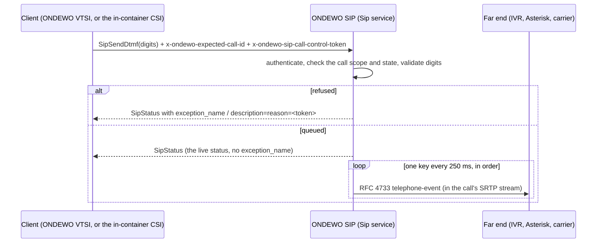
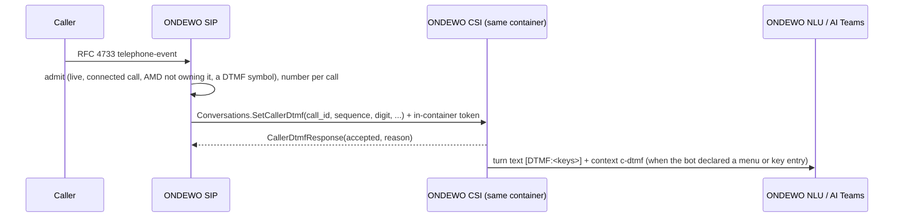

# DTMF keys in the ONDEWO SIP API

This guide describes the DTMF (keypad) features as seen through the `ondewo.sip.Sip` service. The generated reference
of every message and field is [index.md](index.md) (also `index.html`); this page explains how the pieces fit
together. It covers ONDEWO SIP API **5.6.0**.

DTMF travels in two directions on a call that ONDEWO SIP (the SIP endpoint in a per-call container) holds:

| Direction | What happens | API |
| --- | --- | --- |
| **Sending** | the bot's leg presses keys towards the far end, e.g. to navigate the IVR an outbound call reached, or for an operator | `SipSendDtmf` (this API) |
| **Receiving** | the caller presses keys; ONDEWO SIP admits, masks and forwards each key to the speech-to-speech pipeline (ONDEWO CSI), which turns keys into caller turns | no RPC of this API; ONDEWO SIP calls `Conversations.SetCallerDtmf` of the [ONDEWO CSI API](https://github.com/ondewo/ondewo-csi-api/blob/master/docs/dtmf.md) |

Most integrations do not call `SipSendDtmf` directly: ONDEWO VTSI exposes it as `Calls.SendCallDtmf` and adds
authorization, auditing and events (see the
[ONDEWO VTSI API DTMF guide](https://github.com/ondewo/ondewo-vtsi-api/blob/master/docs/dtmf.md)).

## Sending keys: `SipSendDtmf`

```protobuf
rpc SipSendDtmf (SipSendDtmfRequest) returns (SipStatus);

message SipSendDtmfRequest {
    string digits = 1;    // 1 to 64 of 0-9 * # A-D, in order
}
```

### Sequence



The answer means **queued**, not delivered. The keys leave afterwards, one every 250 ms.

### Semantics

- **Keys.** `digits` is a string of 1 to 64 characters, each one of `0`-`9`, `*`, `#`, `A`-`D` (the sixteen DTMF
  symbols, RFC 4733 events 0-15). Anything else, an empty string or more than 64 keys refuses the WHOLE request with
  `InvalidDtmf` and sends nothing; nothing is truncated or filtered.
- **Encoding.** Each key is an RFC 4733 `telephone-event` in the call's media stream. No tone is played into the
  call audio, so neither the bot's speech recognition nor a listener on `SipStreamCallAudio` hears the keys. A peer
  that did not negotiate `telephone-event` in its SDP receives no key; this is not reported.
- **Pacing.** One key every **250 ms**, in the order given, so 64 keys take about 16 s. The gap is what an IVR
  expects between keys, and it keeps the media stack's small event queue from overflowing.
- **Ordering.** Requests are sent strictly one after another by one sender: a second request waits until the keys of
  the first are out, and the keys of two requests never interleave (a PIN cannot be corrupted by a concurrent
  request).
- **Call scope of the queue.** Every request remembers the call it was made for. When that call ends, or its audio
  stream goes away, before all keys are out, the rest of that request is dropped; keys are never sent into the next
  call of a persistent container.
- **Not idempotent.** A retried request presses the keys again. Do not retry a request whose outcome is unknown
  without checking with the far end.

### Metadata and authentication

`SipSendDtmf` is scoped and authenticated like the other in-call RPCs (`SipTransferCall`, `SipMute`, `SipUnMute`,
`SipPlayWavFiles`):

| Metadatum | Meaning |
| --- | --- |
| `x-ondewo-expected-call-id` | `SipStatus.call_id` of the call the keys are meant for. When present it must name the container's current call, otherwise `CallScopeMismatch`. When absent, a peer outside the container is refused (`CallScopeMismatch`, `reason=missing-expected-call-id`) on a container that has a call-control token or that requires call scoping, and accepted (with a server-side warning) otherwise. |
| `x-ondewo-sip-call-control-token` | The per-container call-control token. On a container deployed WITH a token, a peer outside the container must present it, otherwise `CallControlUnauthenticated`. A container deployed without a token serves every peer. |

The in-container speech-to-speech pipeline (ONDEWO CSI, e.g. an agent navigating an IVR) proves that it runs inside
the container with its own in-container token; it needs neither a call id nor the call-control token. A remote client
never sees or sends the in-container token.

The call-control token is derived and delivered by ONDEWO VTSI; treat it like a password and never log it. Use TLS
(the server serves mutual TLS only).

### Preconditions

The request is served only when, in this order:

1. the peer is authenticated (see above), and a present `x-ondewo-expected-call-id` names the current call;
2. the container has a call, it is **connected**, and answering machine detection does not own it (a call whose
   detector runs in `DETECT_ONLY` mode, i.e. converses while it detects, can be controlled);
3. `digits` is valid;
4. the call has an established audio stream.

### Response and refusals

The response is a `SipStatus`. On success it is the live status of the call (`call_id` filled) and `exception_name`
is empty. A refusal is **returned** in the same message and never written to the shared status or its history:
`exception_name` names the refusal and `description` is `reason=<token>`. Nothing was sent when a request is refused.

| `exception_name` | `description` | Meaning |
| --- | --- | --- |
| `CallControlUnauthenticated` | `reason=call-control-token-missing` | The container has a call-control token and the remote peer presented none. |
| `CallControlUnauthenticated` | `reason=call-control-token-invalid` | The presented token is wrong (or presented twice). |
| `CallScopeMismatch` | `reason=missing-expected-call-id` | A remote peer sent no `x-ondewo-expected-call-id` where one is required. |
| `CallScopeMismatch` | `reason=expected-call-id-mismatch` | `x-ondewo-expected-call-id` names another call, or a call that has ended. |
| `NoOngoingCall` | `reason=no-ongoing-call` | There is no call. |
| `NoOngoingCall` | `reason=call-not-connected` | The call is still ringing. |
| `NoOngoingCall` | `reason=no-audio-stream` | The call is connected but has no established audio stream. |
| `AmdInProgress` | `reason=amd-in-progress` | Answering machine detection owns the call (status `OUTGOING_CALL_ANSWERING_MACHINE_DETECTED` with an action other than `DETECT_ONLY`). |
| `InvalidDtmf` | `reason=invalid-digits` | `digits` is empty, longer than 64, or contains a character outside `0-9 * # A-D`. |

Keys dropped AFTER the answer (the call ended while they were queued) are not reported to the client; the server logs
how many were sent and dropped.

## Receiving keys: what happens to a key the caller presses

There is no RPC for this direction in the SIP API; it is described here because the SIP endpoint is where every key
enters the ONDEWO stack.



- **Admission.** A key is taken only from the media stream of the container's live, connected call, while answering
  machine detection does not own it, and only if it is one of the sixteen DTMF symbols. Every other key is refused
  and logged with a reason token, never with the key.
- **Numbering.** Admitted keys are numbered per call, starting at 1. A key that cannot be forwarded keeps its number,
  so the pipeline can tell that a key of an open key entry was lost.
- **Forwarding.** Each key goes in its own `SetCallerDtmf` request to the ONDEWO CSI process in the same container,
  in the order received, with a short deadline (default 0.3 s) and one retry; a key that still cannot be delivered is
  dropped, because a late key would be read as a new press. A key of a call that has already ended is never
  forwarded. Forwarding can be switched off per container (`SIP_DTMF_FORWARD_ACTIVE`, or per call through ONDEWO
  VTSI's `DtmfConfig.enabled`).
- **No echo.** A received key is never played back into the call, so the bot's speech recognition does not hear it.
- **Meaning.** What a key does (a menu choice, a digit of a PIN or customer number, a barge-in over the bot) is
  decided by ONDEWO CSI from what the bot's last answer declared; see the
  [ONDEWO CSI API DTMF guide](https://github.com/ondewo/ondewo-csi-api/blob/master/docs/dtmf.md).

## Security

- **Keys are never logged in clear**, in either direction. Every log line carries `<dtmf:N>` (the number of keys)
  instead of the keys, including refusals and failures; the error text of a failed send is not logged because it can
  contain the key.
- **Telemetry and events carry counts only.** ONDEWO VTSI records `VTSI_EVENT_CALL_DTMF_SENT` and its audit record
  with the NUMBER of keys, never the keys.
- **Authentication** is the call-control token for remote peers and the in-container token for the pipeline in the
  same container, compared in constant time; a missing or wrong token fails closed. Treat `digits` like a password in
  your own client code: it may be a PIN.

## Examples

The Python client is [ondewo-sip-client-python](https://github.com/ondewo/ondewo-sip-client-python) 5.6.0 or later.
The values below are fictional.

Send keys through `Sip.send_dtmf`. Without `metadata=` it attaches only the client's own metadata (the Keycloak
bearer token, when configured), which is enough against a container deployed without a call-control token:

```python
from ondewo.sip.client.client import Client
from ondewo.sip.client.client_config import ClientConfig
from ondewo.sip.sip_pb2 import SipSendDtmfRequest, SipStatus

config: ClientConfig = ClientConfig(host="sip.example.invalid", port="50051")  # TLS settings omitted
client: Client = Client(config=config, use_secure_channel=True)

status: SipStatus = client.services.sip.send_dtmf(SipSendDtmfRequest(digits="1#"))
if status.exception_name:
    print(f"refused: {status.exception_name} {status.description}")
else:
    print(f"queued on call {status.call_id}")
```

A remote peer of a container that has a call-control token must add the call-scope metadata. Every call-scoped
method of the client (`end_call`, `transfer_call`, `play_wav_files`, `mute`, `un_mute`, `set_call_media_control`,
`send_dtmf`, `stream_call_audio`) takes it as `metadata=`, sent after the client's own:

```python
from typing import List, Tuple

call_id: str = client.services.sip.get_sip_status().call_id
call_metadata: List[Tuple[str, str]] = [
    ("x-ondewo-expected-call-id", call_id),
    ("x-ondewo-sip-call-control-token", "<call-control-token>"),  # never hard-code or log the real token
]
status = client.services.sip.send_dtmf(SipSendDtmfRequest(digits="0815#"), metadata=call_metadata)
```

Reading `call_id` right before sending and passing it as `x-ondewo-expected-call-id` makes sure the keys are never
pressed on a later call of the same container.

## Limits

| Limit | Value |
| --- | --- |
| Keys per `SipSendDtmf` | 1 to 64 |
| Key alphabet | `0`-`9`, `*`, `#`, `A`-`D` |
| Interval between two sent keys | 250 ms (64 keys take about 16 s) |
| Keys a caller can enter in one key entry | up to 32 (ONDEWO CSI clamps a declared maximum to 32); entries of 1 to 30 keys are tested end to end on live calls |
| Forwarding deadline of one received key | 0.3 s by default (0.05 - 0.5 s), one retry |

## See also

- [ONDEWO CSI API: DTMF](https://github.com/ondewo/ondewo-csi-api/blob/master/docs/dtmf.md): `SetCallerDtmf` and how
  keys become caller turns.
- [ONDEWO VTSI API: DTMF](https://github.com/ondewo/ondewo-vtsi-api/blob/master/docs/dtmf.md): `Calls.SendCallDtmf`,
  `VTSI_EVENT_CALL_DTMF_SENT` and the per-call `DtmfConfig`.
- Server documentation (ONDEWO SIP): `docs/configuration.md` (`SIP_DTMF_FORWARD_ACTIVE`,
  `SIP_DTMF_FORWARD_RPC_TIMEOUT_IN_S`, call control and the call-control token).
- [RFC 4733](https://www.rfc-editor.org/rfc/rfc4733): RTP payload for DTMF digits, telephony tones and signals.
