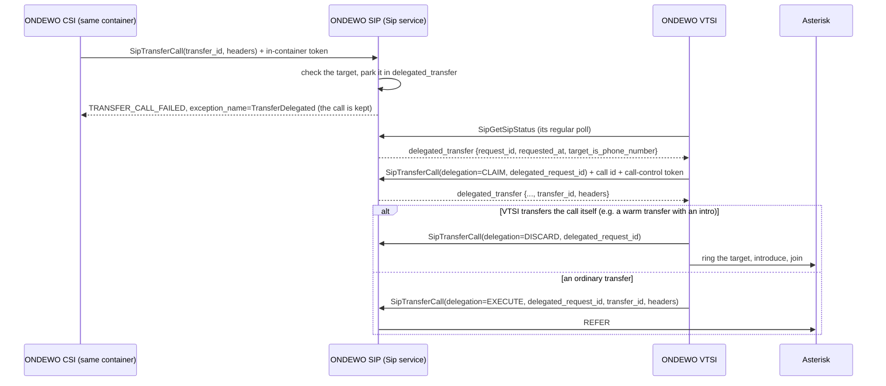

# Warm transfers in the ONDEWO SIP API

This guide describes the two pieces of the `ondewo.sip.Sip` service that a warm transfer with an intro builds on. The
generated reference of every message and field is [index.md](index.md) (also `index.html`); this page explains how
the pieces fit together. It covers ONDEWO SIP API **5.7.0**.

In a warm transfer with an intro the caller stays with the bot while ONDEWO VTSI rings the transfer target, and a
second bot introduces the call to the target before the target is joined. The SIP endpoint of the caller's call (a
per-call container running ONDEWO SIP and the speech-to-speech pipeline ONDEWO CSI) takes part twice:

| Piece | What it does | API |
| --- | --- | --- |
| **Transfer delegation** | a transfer the bot asks for is parked in the container instead of being sent, so ONDEWO VTSI can decide how to transfer the call | `SipStatus.delegated_transfer`, `SipTransferCallRequest.delegation` |
| **Outcome notice** | when the transfer does not happen (declined, unreachable), the bot is told why, so it can tell the caller | `SipSetCallMediaControlRequest.warm_transfer_outcome`, `SipStatus.warm_transfer_outcome_notice_status` |
| **Capabilities** | a client finds out whether a container supports the notice before it relies on it | `SipStatus.capabilities` |

Most integrations do not call these directly: ONDEWO VTSI claims delegated transfers and sends the notice itself (see
the [ONDEWO VTSI API](https://github.com/ondewo/ondewo-vtsi-api)). No RPC and no `SipStatus.StatusType` value was
added, and every new field's zero value is the behaviour of 5.6.0.

## Transfer delegation

```protobuf
enum SipTransferDelegation {
    SIP_TRANSFER_DELEGATION_UNSPECIFIED = 0;   // an ordinary transfer, as before
    SIP_TRANSFER_DELEGATION_CLAIM = 1;         // read the parked target and headers, stop the expiry
    SIP_TRANSFER_DELEGATION_EXECUTE = 2;       // end the delegation, send THIS request's transfer
    SIP_TRANSFER_DELEGATION_DISCARD = 3;       // end the delegation, send nothing
}

message SipTransferCallRequest {
    string transfer_id = 1;
    map<string, string> headers = 2;
    uint32 outcome_timeout_ms = 3;
    SipTransferDelegation delegation = 4;
    string delegated_request_id = 5;           // = SipStatus.delegated_transfer.request_id
}

message SipDelegatedTransfer {                 // SipStatus.delegated_transfer = 17
    string request_id = 1;
    google.protobuf.Timestamp requested_at = 2;
    bool target_is_phone_number = 3;
    string transfer_id = 4;                    // only in the response of a CLAIM
    map<string, string> headers = 5;           // only in the response of a CLAIM
}
```

### Sequence



### Semantics

- **Off by default.** A container parks transfers only when it was started with
  `SIP_TRANSFER_DELEGATION_ACTIVE=True`. Without it, and for every request with
  `delegation = SIP_TRANSFER_DELEGATION_UNSPECIFIED` from any peer other than the in-container pipeline, a transfer
  is sent exactly as in 5.6.0. ONDEWO VTSI starts a container with delegation only when it also runs the claimer.
- **What is parked.** Only a transfer the in-container pipeline asks for on a connected call, after the transfer
  target policy accepted the target. A refused target is refused as before and nothing is parked.
- **The park is an answer, not a failure.** The pipeline receives `TRANSFER_CALL_FAILED` with
  `exception_name=TransferDelegated` and `description = reason=delegated-to-vtsi`, keeps the call and carries on with
  the conversation. Nothing is written to the call's status type, so no transfer is reported as failed.
- **One at a time.** A second transfer of the pipeline while one is parked is refused with `TransferInProgress`.
- **The status does not show the target.** `SipGetSipStatus`, `SipGetSipStatusHistory` and every other response
  report only `request_id`, `requested_at` and `target_is_phone_number`. `target_is_phone_number` is the verdict of
  the container's transfer target policy (a `+` followed by digits, or a trunk-routed number) and is `false` for an
  account name such as a softphone. The target and the headers are filled only in the response of a CLAIM.
- **CLAIM** returns the target and the headers, sends nothing, and stops the expiry clock: a claimed transfer never
  expires. It stays parked until EXECUTE, DISCARD or the end of the call; a repeated CLAIM answers the same.
- **EXECUTE** ends the delegation and sends the transfer of the request itself (`transfer_id`, `headers`,
  `outcome_timeout_ms`), exactly like an ordinary `SipTransferCall`, with the same outcomes and refusals. The client
  may send the target it got from CLAIM, or the target after its own resolution.
- **DISCARD** ends the delegation and sends nothing. The call stays with the bot; the client transfers it by other
  means or tells the bot with an outcome notice.
- **Expiry.** A parked transfer that is not claimed within `SIP_TRANSFER_DELEGATION_CLAIM_TIMEOUT_S` (10 s by default)
  is dropped **without a REFER**, and the pipeline is told with `SIP_WARM_TRANSFER_OUTCOME_DELEGATION_EXPIRED`, which
  runs its usual handling of a failed transfer. A REFER into a conversation that has moved on is never sent blind.
- **Call scope.** The parked transfer belongs to its call: it is empty when no call is ongoing and is cleared when the
  call ends, so it never reaches the next call of a persistent container.

### Metadata and refusals

Every `delegation` other than `SIP_TRANSFER_DELEGATION_UNSPECIFIED` requires:

| Metadatum | Meaning |
| --- | --- |
| `x-ondewo-sip-call-control-token` | The per-container call-control token. Missing or wrong: `CallControlUnauthenticated`. A container deployed without a token refuses every claim. |
| `x-ondewo-expected-call-id` | `SipStatus.call_id` of the ongoing call. Missing or naming another call: `CallScopeMismatch`. |

A refusal is **returned** in the response (`exception_name` and `description = reason=<token>`) and never written to
the shared status or its history; nothing was sent and nothing was claimed.

| `exception_name` | Meaning |
| --- | --- |
| `TransferDelegated` | Not a refusal of a claim: the answer to the pipeline that its transfer was parked. |
| `DelegatedRequestMismatch` | No transfer is parked, or `delegated_request_id` names another one (an expired one, or one of an earlier call). Do not retry: the transfer is gone. |
| `CallControlUnauthenticated` | The call-control token is missing or wrong. |
| `CallScopeMismatch` | `x-ondewo-expected-call-id` is missing or names another call. |
| `TransferInProgress` | The pipeline asked for a second transfer while one is parked, or a transfer of the call is in flight. |

## Warm-transfer outcome notice

```protobuf
enum SipWarmTransferOutcome {
    SIP_WARM_TRANSFER_OUTCOME_UNSPECIFIED = 0;
    SIP_WARM_TRANSFER_OUTCOME_DECLINED = 1;
    SIP_WARM_TRANSFER_OUTCOME_UNREACHABLE = 2;
    SIP_WARM_TRANSFER_OUTCOME_DELEGATION_EXPIRED = 3;   // set by ONDEWO SIP only
}

message SipWarmTransferOutcomeNotice {          // SipSetCallMediaControlRequest.warm_transfer_outcome = 5
    string request_id = 1;
    SipWarmTransferOutcome outcome = 2;
    string intro_session = 3;
    string callee_display_name = 4;             // at most 128 characters
    string cause = 5;                           // a stable token, never free text
    string fallback_text = 6;                   // never a reason the target gave
}
```

While a warm transfer rings, ONDEWO VTSI holds the bot muted and paused with the participant owner of
`SipSetCallMediaControl`. When the transfer does not happen, the request that releases that hold carries the notice,
so the bot hears about the outcome only once it can speak.

- **Participant owner only.** The notice is accepted only with `owner = MEDIA_CONTROL_OWNER_PARTICIPANT`, an outcome
  of `SIP_WARM_TRANSFER_OUTCOME_DECLINED` or `SIP_WARM_TRANSFER_OUTCOME_UNREACHABLE`, and a non-empty `request_id`.
  Anything else is refused with `exception_name=InvalidWarmTransferOutcomeNotice` and changes nothing, the level
  included. The request needs the same metadata as every `SipSetCallMediaControl` request.
- **Always handed over.** ONDEWO SIP hands the notice to the pipeline after the level, also when the level did not
  change (for example an operator still holds a mute). The pipeline tells the caller at most once per `request_id`
  and call, at a moment it chooses, and only while the bot can speak.
- **Call scope.** A pending notice is dropped when the call ends and never reaches the next call.

The answer of the pipeline is returned in `SipStatus.warm_transfer_outcome_notice_status` of the response:

| Status | Meaning |
| --- | --- |
| `..._UNSPECIFIED` | The request carried no notice. |
| `..._QUEUED` | The pipeline accepted it and tells the caller, unless the call ends first. |
| `..._DUPLICATE` | The pipeline already has a notice with this `request_id` on this call. |
| `..._DISABLED` | The pipeline does not tell callers about warm-transfer outcomes; the notice is dropped. |
| `..._INVALID` | The pipeline refused the notice as malformed; the notice is dropped. |
| `..._PENDING` | The pipeline did not answer. The notice is kept and handed over again until it answers, and dropped when the call ends. |

Treat anything but `QUEUED` and `DUPLICATE` as "the caller may not be told".

**What the bot says.** The pipeline has the NLU phrase the outcome when the NLU supports it (with the intro
session in `intro_session`, so the bot can relay what the target said). Otherwise it speaks `fallback_text`, which
the client renders from a template and which never contains a reason the target gave.

## Capabilities

`SipStatus.capabilities` (field 18) lists optional features of the container as stable tokens. It is fixed for the
life of the container and the same on every status. An empty list, which is what a container built before 5.7.0
reports, means none of them. Ignore tokens you do not know.

| Token | Meaning |
| --- | --- |
| `warm-transfer-outcome-notice` | The container hands `warm_transfer_outcome` to its pipeline and the pipeline tells the caller. Reported only when the pipeline of the container has the feature switched on. |

Check it before you ring a target whose outcome you will have to report: a container without the token cannot tell
the caller.

## Security

- **The target and the headers are not in the status.** Phone numbers and the headers the bot sent are returned only
  to an authenticated CLAIM, never by `SipGetSipStatus`, which any peer of the container may call.
- **The notice carries no free text from the target.** `cause` is a token and `fallback_text` is rendered by the
  client from its own template. Log neither `fallback_text` nor the claimed target in your own client code.
- **Authentication** is the call-control token, compared in constant time; a missing or wrong token fails closed.
  The token is derived and delivered by ONDEWO VTSI; treat it like a password. The server serves mutual TLS only.

## Examples

The Python client is [ondewo-sip-client-python](https://github.com/ondewo/ondewo-sip-client-python) 5.7.0 or later.
The values below are fictional.

Claim a parked transfer, then execute it:

```python
from typing import List, Tuple

from ondewo.sip.client.client import Client
from ondewo.sip.client.client_config import ClientConfig
from ondewo.sip.sip_pb2 import SipStatus, SipTransferCallRequest, SipTransferDelegation

config: ClientConfig = ClientConfig(host="sip.example.invalid", port="50051")  # TLS settings omitted
client: Client = Client(config=config, use_secure_channel=True)

status: SipStatus = client.services.sip.get_sip_status()
request_id: str = status.delegated_transfer.request_id
if request_id:
    call_metadata: List[Tuple[str, str]] = [
        ("x-ondewo-expected-call-id", status.call_id),
        ("x-ondewo-sip-call-control-token", "<call-control-token>"),  # never hard-code or log the real token
    ]
    claimed: SipStatus = client.services.sip.transfer_call(
        SipTransferCallRequest(
            delegation=SipTransferDelegation.SIP_TRANSFER_DELEGATION_CLAIM,
            delegated_request_id=request_id,
        ),
        metadata=call_metadata,
    )
    if not claimed.exception_name:
        sent: SipStatus = client.services.sip.transfer_call(
            SipTransferCallRequest(
                transfer_id=claimed.delegated_transfer.transfer_id,
                headers=dict(claimed.delegated_transfer.headers),
                outcome_timeout_ms=3000,
                delegation=SipTransferDelegation.SIP_TRANSFER_DELEGATION_EXECUTE,
                delegated_request_id=request_id,
            ),
            metadata=call_metadata,
        )
```

Release the participant hold and tell the bot that the target declined:

```python
from ondewo.sip.sip_pb2 import (
    MediaControlOwner,
    MediaControlSetting,
    SipSetCallMediaControlRequest,
    SipWarmTransferOutcome,
    SipWarmTransferOutcomeNotice,
    SipWarmTransferOutcomeNoticeStatus,
)

released: SipStatus = client.services.sip.set_call_media_control(
    SipSetCallMediaControlRequest(
        bot_voice=MediaControlSetting.MEDIA_CONTROL_SETTING_ON,
        bot_listening=MediaControlSetting.MEDIA_CONTROL_SETTING_ON,
        owner=MediaControlOwner.MEDIA_CONTROL_OWNER_PARTICIPANT,
        participants_present=False,
        warm_transfer_outcome=SipWarmTransferOutcomeNotice(
            request_id="7b0c5f1e-0000-4000-8000-000000000000",
            outcome=SipWarmTransferOutcome.SIP_WARM_TRANSFER_OUTCOME_DECLINED,
            callee_display_name="Frau Berger",
            fallback_text="Frau Berger kann Ihren Anruf gerade nicht annehmen.",
        ),
    ),
    metadata=call_metadata,
)
told: bool = released.warm_transfer_outcome_notice_status in (
    SipWarmTransferOutcomeNoticeStatus.SIP_WARM_TRANSFER_OUTCOME_NOTICE_STATUS_QUEUED,
    SipWarmTransferOutcomeNoticeStatus.SIP_WARM_TRANSFER_OUTCOME_NOTICE_STATUS_DUPLICATE,
)
```

## Limits

| Limit | Value |
| --- | --- |
| Parked transfers per call at a time | 1 |
| Time to claim a parked transfer | `SIP_TRANSFER_DELEGATION_CLAIM_TIMEOUT_S`, 10 s by default; a claimed transfer never expires |
| `callee_display_name` | at most 128 characters |
| Notices told to the caller | at most one per `request_id` and call |

## See also

- [DTMF in the ONDEWO SIP API](dtmf.md): the call-control token and the call-scope metadata in detail.
- [ONDEWO VTSI API](https://github.com/ondewo/ondewo-vtsi-api): `Calls.TransferCall` with a warm transfer and its
  intro.
- [ONDEWO CSI API](https://github.com/ondewo/ondewo-csi-api): how the pipeline receives the notice.
- Server documentation (ONDEWO SIP): `docs/configuration.md` (`SIP_TRANSFER_DELEGATION_ACTIVE`,
  `SIP_TRANSFER_DELEGATION_CLAIM_TIMEOUT_S`, call control and the call-control token).
